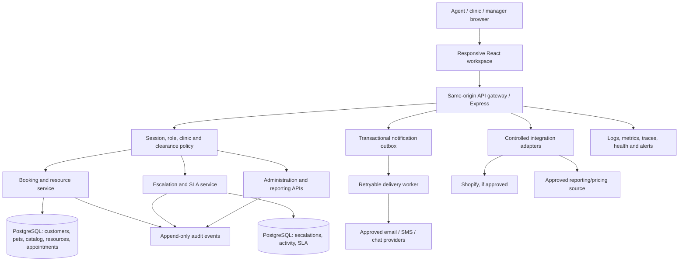
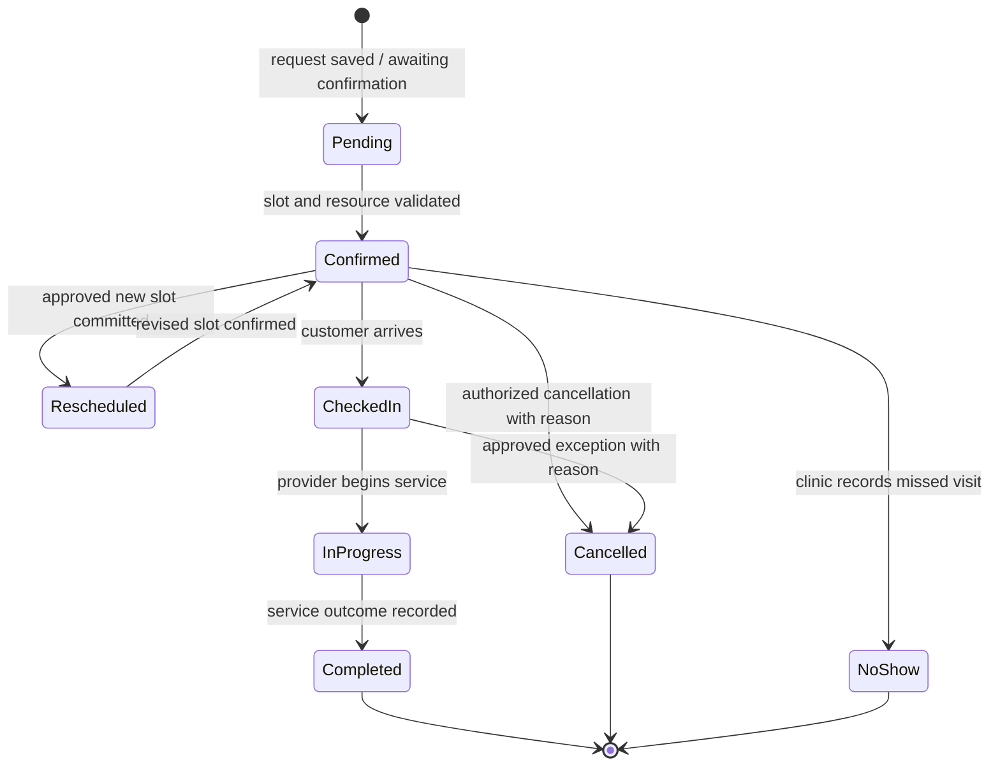
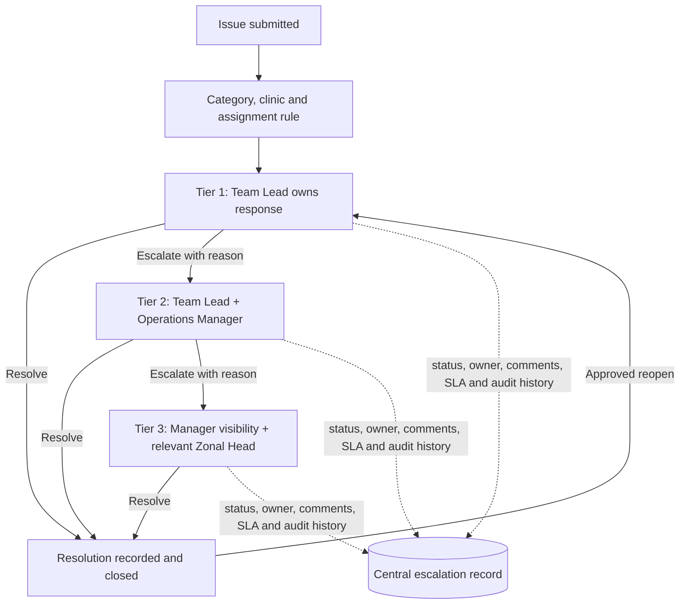
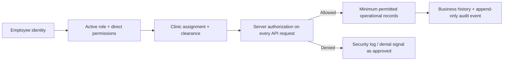
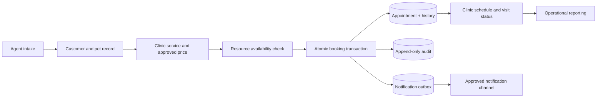

# Bark — Business Requirements Document

## 1. Cover Page

| Document field | Value |
|---|---|
| Project | **Bark — Supertails Clinic Operations & Appointment Management Platform** |
| Organization | Supertails |
| Document type | Business Requirements Document (BRD) |
| Version | 1.0 — Draft for management review |
| Prepared | 15 November 2026 |
| Intended audience | Team Leads, Operations Managers, Department Heads, Product/Engineering leadership, Senior Management |
| Decision requested | Approve discovery and define the pilot MVP boundary, owners, and acceptance gates |

> **Evidence notice:** This document separates code-derived facts from proposed business requirements, hypotheses, assumptions, and decisions. A visible screen does not prove a backend workflow exists. No operational savings or production-readiness claim is inferred from the prototype.

## 2. Document control and version history

| Version | Date | Change | Owner/status |
|---|---|---|---|
| 1.0 | 15 Nov 2026 | Initial BRD based on repository and project-document review | Draft; management and business-owner review required |

## 3. Executive summary

Bark is an internal operations platform intended to unify clinic appointment booking, customer and pet context, issue escalation, clinic coordination, staff administration, and management visibility. The current repository contains a meaningful React/Express/PostgreSQL foundation, including secure session handling, server permissions, booking/customer/pet APIs, audit records, calendar endpoints, administrative APIs, and an operational summary.

The current product is a local prototype/backend MVP, not a production-ready operating system. The booking screen supports a creation path, but not the full appointment lifecycle or provider-aware scheduling. The escalation UI still uses local browser storage despite a separate backend. Chat is a preview, some dashboard values are static, the admin interface exposes only part of the APIs, and notifications have no delivery worker. These gaps are detailed in [the current-state assessment](BARK_CURRENT_STATE_ASSESSMENT.md).

The recommended decision is to approve Phase 0 requirements validation and a limited clinic pilot, with production approval conditional on role/clinic security tests, atomic resource-aware scheduling, end-to-end booking and escalation workflows, audit investigation, backup/restore, notification delivery, and clinic UAT. The proposed effort is 103–159 person-days across all phases; the MVP through pilot is estimated at 88–134 person-days, subject to Phase 0 recalibration.

## 4. Business background and problem statement

Supertails clinic work involves customers, pets, service eligibility, appointment slots, clinic/provider capacity, employee handoffs, and operational exceptions. The project direction is to put these activities in one internal role-based workspace.

### Operational hypotheses to validate

The following are proposed business problems from the project brief, not confirmed findings:

- Separate tools may create repeated entry and inconsistent customer/appointment records.
- Agents and clinics may coordinate appointment availability manually.
- Staff may not see the same booking state or available capacity.
- Scheduling conflicts may cause rework or customer inconvenience.
- Issue ownership and escalation timing may be difficult to reconstruct.
- Manual reporting may delay decisions or require reconciliation.
- Agents may repeat routine steps that could be supported by structured workflows.
- Agent, clinic, and management communication may be fragmented.

Phase 0 should validate each hypothesis using workflow observation, existing-system data, interviews, and a measured baseline. The BRD does not claim that these problems occur at a particular frequency or cost.

## 5. Business objectives

1. Make customer, pet, service, clinic, and appointment context available in one authorized workflow.
2. Offer only valid appointment capacity and prevent resource conflicts under concurrent requests.
3. Give each appointment and escalation a durable owner, state, and history.
4. Reduce avoidable manual coordination and make handoffs easier to act on.
5. Provide management with reproducible, freshness-labeled operational measures.
6. Maintain privacy, role/clinic boundaries, and append-only audit history for important changes.
7. Deliver a supportable platform that can be piloted, measured, recovered, and expanded deliberately.

Targets and ROI commitments require a baseline and management approval.

## 6. Project vision

Bark is envisioned as the operational workspace between customer-facing booking teams and clinic staff. Agents capture the request; the system connects customer/pet/service information to a clinic resource and time; the clinic manages the appointment through its outcome; escalations route issues to accountable roles; and management sees metrics derived from the same operational records.

The platform should integrate with existing systems only where Supertails approves the source of truth, privacy boundary, data owner, and failure behavior. It should complement—not silently overwrite—systems of record during migration and pilot.

## 7. Current operational challenges and value hypotheses

| Hypothesis | Bark capability intended to address it | Evidence needed to validate value |
|---|---|---|
| Disconnected workflows create repeated work | Customer profile, booking, escalation, and clinic views linked by IDs | Count duplicate entries and median handling time before/after pilot |
| Manual slot coordination causes delay/conflicts | Resource-aware availability and atomic booking | Conflict attempts, confirmed collisions, and minutes spent coordinating |
| Ownership is unclear after a handoff | Assigned booking/escalation owner and activity/audit trail | Time to identify current owner and percentage of events with actor/reason |
| Reporting requires manual reconciliation | API-backed dashboards with formulas and freshness metadata | Difference between report and source records; report-preparation time |
| Agents repeat routine tasks | Search, structured intake, catalog, and reusable customer/pet context | Steps/clicks or time per booking; error/rework rate |
| Clinic/agent communication is delayed | Notifications and, later, persisted chat | Delivery success and response time; staff adoption and audit needs |
| Booking leakage affects revenue/customer experience | Lifecycle, capacity, cancellation/no-show insight, billing integration later | Verified lost capacity, booking errors, and contribution margin |

Potential benefits are prospective; they are not yet measured or attributable to Bark.

## 8. Proposed solution

Bark should provide authenticated, permission-controlled modules over a shared PostgreSQL record set. Clinic service and resource configuration determines which services can be booked and when. Appointment create/update transitions are validated on the server and recorded with actor and reason. Escalations share the same access, ownership, notification, and audit principles. Reporting uses versioned metric definitions and identifies its source and refresh time. Integrations operate through documented contracts with retry and reconciliation behavior.

## 9. Current development status

| Capability | Status |
|---|---|
| React SPA and Express REST API | Implemented; recent typecheck/build succeeded. Deployment readiness is incomplete. |
| PostgreSQL/Drizzle schema and migrations | Implemented. Test and recovery coverage remains incomplete. |
| Login/session/role authorization | Implemented in source; locally exercised in project work; not production security-certified. |
| Customer/pet search and booking creation | Partial live API workflow. |
| Appointment lifecycle/resource scheduling | Partial; provider, capacity, clinic-specific hours/timezone, and status actions remain gaps. |
| Escalation backend | Implemented as a separate API/schema layer. |
| Escalation screens | Mock/localStorage; not connected to the operational backend. |
| Admin APIs and UI | APIs cover more than the current admin screen. |
| Operational dashboard | Summary API exists; sample/static cards remain. |
| Clinic Chat | Frontend preview only. |
| Diagnostics pricing | Browser-side CSV reader for an external workbook; read-only and not a managed sync. |
| Quote generator | Recent frontend feature; prices can be edited, discount is manually entered, and quote is not persisted. |
| Shopify and email delivery | Not implemented. |
| Audit | Append-only database trigger and transactional event helper exist; complete coverage/search/retention remain to be verified. |

See the detailed evidence and file references in [BARK_CURRENT_STATE_ASSESSMENT.md](BARK_CURRENT_STATE_ASSESSMENT.md).

## 10. Project scope

### In scope for the proposed pilot MVP

- Staff access, role/clinic scope, user lifecycle, profile, and supported password recovery.
- Customer/pet intake and controlled record editing.
- Clinic catalog and price source, scheduling resources, availability, appointment lifecycle, and audit history.
- Clinic schedule/queue and role-appropriate staff workflows.
- Database-backed escalation intake, tiering, assignment, SLA, discussion, resolution, history, and essential notifications.
- Core operational dashboard with agreed formulas, source, and freshness.
- Admin controls needed for pilot users, clinic/service/workflow settings, access review, and audit lookup.
- Production deployment, backup/recovery, logs, test automation, training, and controlled rollout.

### Out of scope for the first production pilot unless management approves otherwise

- Shopify order/payment/refund automation.
- Customer-facing web/mobile portal.
- Real-time chat with attachments and retention before access/retention policy is agreed.
- Predictive staffing, automated incentive payout, or generative agent decisions.
- Multi-region high availability or a microservice rewrite.
- Replacing every existing CX/clinic system before data and ownership are approved.

## 11. Stakeholders

| Stakeholder | Accountability in the initiative |
|---|---|
| Executive sponsor / Department Head | Sponsor, scope, investment, risk acceptance, pilot expansion decision |
| Operations Manager | Own operating model, SLA/escalation policy, operational measures and support process |
| Sales/CX Team Lead | Validate agent intake, coaching, booking attribution, and team reporting |
| Clinic Manager / Front Desk lead | Own clinic queue, provider capacity, operating hours, and UAT |
| Doctor/Veterinarian and Groomer representatives | Validate appointment duration, eligibility, visit lifecycle, and safe workload |
| Product Manager / Business Analyst | Maintain requirements, decisions, traceability, and acceptance criteria |
| Engineering Lead / Developers | Architecture, implementation, security, migration, and runbooks |
| QA / Security reviewer | Independent integration, access, concurrency, privacy, and release verification |
| Data/Privacy/Finance owners | Approve data use/retention, pricing/discount authority, and reconciliation rules |
| IT/Procurement | Hosting, identity, email, network, vendor, and support approvals |

These roles are proposed responsibilities; named individuals and capacity need assignment.

## 12. User roles and responsibilities

Backend role keys currently include Sales Agent, Clinic Front Desk, Doctor, Groomer, Sales Team Lead, Clinic Manager, Sales Manager, Zonal Head, Central Management, System Administrator, and GOD/Super Admin. “Operations Manager” in the project vision is not a distinct seeded role; leadership must decide whether to map it to a current role or add one.

| Role | Proposed business responsibility |
|---|---|
| Sales/CX Agent | Search/create customer, record pet/service intent, offer approved slots, confirm booking, communicate changes, raise issue |
| Team Lead | Review agent queue, assist booking exceptions, own Tier 1 escalations, coach team, escalate when required |
| Operations Manager / Sales Manager | Monitor multi-team performance, own Tier 2 issues and operational exceptions, approve defined overrides |
| Clinic Front Desk | Review clinic day list, assign or coordinate provider, check in customer, update allowed appointment state, resolve queue issues |
| Doctor/Veterinarian | Review clinical schedule and relevant records, perform consultation, record visit outcome within approved clinical scope |
| Groomer | Review assigned grooming appointments and eligibility information; update service progress/outcome within role scope |
| Clinic Manager | Own clinic capacity, staffing coordination, clinic escalations, service configuration requests, and UAT |
| Zonal Head | Receive appropriate Tier 3 visibility/escalations; coordinate clinics in approved zone |
| Central Management | View cross-clinic information and coordinate enterprise operational issues as authorized |
| System Administrator | Operate user, role, clinic, workflow, settings, and audit controls without changing business records silently |
| GOD/Super Admin | Emergency/owner-level access with stronger controls, reason capture, monitoring, and immutable history |

Proposed role-to-action acceptance is in the [access-control matrix](BARK_REQUIREMENTS_MATRIX.md#2-access-control-overview). Scope must be checked by clinic assignment and data ownership, not by hiding a button alone.

## 13. Business process overview

The core operating chain is:

`Customer request → identify/create customer → select/verify pet → select clinic/service → validate provider/resource capacity → confirm appointment → notify customer/clinic → check-in and deliver service → record outcome → analyze operational result`

An operational exception follows:

`Issue observed → classify and link relevant record → route to accountable owner → monitor response SLA → comment/transfer/escalate → resolve and record outcome → review trend`

## 14. Detailed functional requirements

Requirements are uniquely identified as `BR-FR-###`. The complete table includes justification, user, priority, status, dependencies, measurable acceptance, and code source in [BARK_REQUIREMENTS_MATRIX.md](BARK_REQUIREMENTS_MATRIX.md). Must-have items for the MVP are authentication/access, customer/pet data controls, catalog and pricing authority, scheduling integrity, appointment lifecycle, audit, escalation integration, essential notifications, reporting basics, backup/recovery, and release verification.

## 15. Non-functional requirements

The following are **proposed acceptance targets**, not existing contractual SLAs. Operations/Engineering must confirm targets and measurement method before release.

| Area | Proposed requirement / acceptance |
|---|---|
| Performance | Interactive pages should return useful content promptly; proposed pilot target: authenticated API p95 under 750 ms for common reads and under 1.5 s for ordinary writes at expected pilot load, excluding external providers. Load-test with representative data. |
| Reliability | Booking and escalation writes must be atomic with their history/audit records. Failed writes must not leave a partial booking, assignment, or transition. |
| Availability | Management must approve a pilot service-hours objective and maintenance window. Do not claim an uptime percentage before hosting/monitoring selection. |
| Scalability | Start with 10–30 internal users and a small pilot; capacity test to at least 3× expected simultaneous user/API load before wider rollout. Validate database indexes and report query bounds. |
| Security | TLS; managed secrets; strong session and password policy; least-privilege DB identity; server-side role/clinic checks; state-changing trusted-origin protection; security review; no credentials in logs or docs. |
| Privacy | Minimize customer and pet personal data, enforce clinic/role visibility, define retention/export/correction policy, and review third-party data flow before integration. |
| Data integrity | Resource-aware conflict prevention must be transactional under concurrent writes. Status transitions must be valid and historical records reconstructable. |
| Auditability | Critical mutations must create immutable events in the same transaction; event coverage, actor, before/after, reason, timestamp, and request correlation must be tested. |
| Recovery | Encrypted scheduled backups, restore rehearsal, and approved RPO/RTO. Targets require management approval and should reflect business loss tolerance. |
| Maintainability | Keep modular boundaries; version API contracts; forward migrations; code review; automated test gates; operator setup/runbook. Avoid direct unreviewed production DB changes. |
| Observability | Health/readiness, structured logs, correlation IDs, error/latency, database and notification status, alert ownership, and privacy-safe telemetry. |
| Accessibility | Keyboard operation, visible focus, labels, error announcements, contrast, responsive clinic desk use, and reduced-motion behavior for core journeys. |

## 16. Module specifications

### 15.1 Authentication and access control

Use server-verified sessions and role permissions. Account status and clinic scope apply to all API reads/writes. Privilege changes require reason/audit and appropriate session revocation. Super-admin access is not permission to erase audit history or bypass transactional controls. The current code has scrypt password hashing, hashed opaque session tokens, login/reset throttling, trusted-origin enforcement, and permission middleware. Deployment controls and matrix testing remain.

### 15.2 Appointment booking management

The intended flow links a caller to an existing/new customer, one of their pets, a service catalog entry, clinic, resource, time slot, and confirmation. For the discussed first booking rules, the catalog includes General/Follow-up/Surgery consultation (30 minutes each), IV Drip (60 minutes), vaccination/deworming (15 minutes), Fit-to-Travel Certificate (30 minutes), long-coat grooming (90 minutes), short-coat grooming (60 minutes), and Bath and Dry (60 minutes). These are current agreed product rules from the project conversation; clinic owners should approve them before broad rollout and confirm whether clinic overrides are allowed.

The server, not the browser, calculates end time. Appointment availability must be driven by provider/room/equipment capacity, clinic operating hours, service duration, and relevant pet eligibility. A slot confirmation rechecks availability atomically. Create, assign, reschedule, cancel, check-in, complete, and no-show events carry user, timestamp, prior/new state, and reason as appropriate.

Current gap: the API rejects every overlap at a clinic and serializes create by clinic. It lacks a complete provider/resource model in the UI and clinic-specific operating-hour/timezone enforcement. This prevents safe parallel appointments and does not meet target capacity behavior.

### 15.3 Clinic operations

Front desk needs a day queue with unassigned, upcoming, checked-in, delayed, in-progress, completed, cancelled, and no-show states. It should assign only qualified active staff and expose capacity conflicts. Doctor/groomer views should be limited to assigned appointments and relevant records. Managers need a clinic-level exception/coverage view. The current appointment page is a live list/timeline foundation but has no lifecycle actions or booking assignment flow.

### 15.4 Escalation and issue management

Proposed levels: Tier 1 to Team Lead; Tier 2 to Team Lead and Operations Manager; Tier 3 visible to Team Lead/Manager with escalation to the relevant Clinic Zonal Head. This proposal needs explicit routing and visibility rules. Issue severity, priority, tier, and SLA are distinct:

- **Severity:** operational/customer impact of the issue.
- **Priority:** ordering for work, derived from impact/urgency under an approved policy.
- **Tier:** management/ownership level involved.
- **SLA:** time target for defined response or resolution milestone.

The data/API foundation supports categories, owners, assignment, status, tier, comments, policy/SLA deadlines, notifications-outbox rows, and audit. The screens currently use mock/localStorage service, so the organization does not yet have a single operational case record through the UI. Do not treat locally recorded notification activity as delivery.

### 15.5 Sales/CX agent workspace

Provide customer search, booking intake, existing appointment history, authorized escalation creation, agent-attributed bookings, queue and follow-up shortcuts, and clearly defined personal/team measures. Daily targets and incentives should be configuration/data, not static code. The current home includes an API-backed operational summary plus fixed snapshot/goal/quality samples.

### 15.6 Management dashboard

The first management release should provide truthful totals and freshness before advanced analytics. Every measure needs a data owner, definition, time basis, inclusion/exclusion rule, and reconciliation sample. Proposed formulas are in Section 23. The current `/api/dashboard/summary` is a foundation; source and static metric limits are detailed above.

### 15.7 Admin control center

Allow authorized administrators to create/update accounts, assign roles/clinics, change approved operational settings, view audit history, and revoke sessions. Changes must be scoped and audited. GOD-level access should require strong authentication and emergency reason capture. Current APIs exceed the current UI surface; do not assume that every endpoint is exposed in the product.

### 15.8 Billing and Shopify

No live Shopify integration exists. Before implementation, approve service-to-SKU mapping, price/tax source, quote-to-order transition, cancellation/refund semantics, idempotency, reconciliation, permissions, and API ownership. A read-only service catalog or quote should not be described as a payment/order integration.

### 15.9 Notifications and communication

Trigger/recipient matrix must cover booking confirmed/changed/cancelled, assignment, escalation created/transferred/tier-changed, SLA warning/breach, and operational failure. Start with a supported channel that has accountable delivery and retries. Chat is a separate product capability requiring conversation authorization, retention, search, unread status, and attachment controls.

### 15.10 Audit and accountability

Treat audit events as append-only evidence separate from editable business state. Store actor ID/role, action, entity, timestamp, previous/new value, reason, request/correlation ID, origin module, and relevant references. Do not log credentials or unnecessary personal data. Access to audit search is privileged and itself monitored. The migration blocks update/delete on the audit table; application coverage and an investigator workflow still need acceptance.

### 15.11 Quote generator

The current screen can assemble services, quantities, manually controlled rates/discounts, and print a quote. To make it an operational record, persist a price snapshot and quote status/expiry; record creator/approver; centrally enforce discount eligibility/caps; and define accepted/expired/revised states. Management confirmed manually approved discounts are sufficient for the initial UI, but no organization-wide code or approval rules are configured.

## 17. End-to-end user journeys

For each workflow, audit event means a proposed required event. Notification delivery depends on an approved provider. Exceptions must produce an actionable message and preserve prior state.

### 16.1 Agent creates a booking

- **Trigger/actor:** customer calls; Sales/CX Agent has active account and booking permission.
- **Preconditions:** agent can access the selected clinic; clinic/service is active; business pricing and duration rules are available.
- **Main steps:** search phone → select profile or create customer → select/create pet → select clinic/service → choose eligible resource/time → review → confirm.
- **Alternate/exception:** customer exists but pet does not; unknown breed/coat; no available slots; service not offered; duplicate phone; conflict on confirm. UI provides correction/next action and does not make partial booking.
- **Outcome/notification:** booking has stable reference and appears in authorized clinic schedule; customer/clinic confirmation is sent using the approved channel.
- **Audit:** customer/pet created/changed as applicable; booking created with actor, pet/service/clinic/slot, and request correlation.

### 16.2 Agent modifies or cancels a booking

- **Trigger/actor:** customer requests a change; agent has booking update/cancel permission.
- **Preconditions:** booking is active, visible to agent, reason captured, target slot meets clinic/resource rules.
- **Main steps:** find booking → confirm customer/pet/reference → choose reschedule or cancel → enter reason → server rechecks state/resource under transaction → confirm.
- **Alternate/exception:** already completed/cancelled, unauthorized clinic, resource conflict, invalid transition, or stale client state; leave record unchanged and explain.
- **Outcome/notification:** updated schedule and customer/clinic messages reflect committed state only.
- **Audit:** previous/new time or status, reason, actor, timestamp, request ID; booking history entry.

### 16.3 Clinic front desk processes an appointment

- **Trigger/actor:** start of clinic shift or customer arrival; Front Desk has assigned-clinic access.
- **Preconditions:** daily queue loaded; provider/room status and appointment state current.
- **Main steps:** review queue → resolve unassigned appointments → verify arrival → check in → coordinate delay/room/provider → mark ready/in progress or request reschedule.
- **Exceptions:** late arrival, no-show threshold, provider absence, service eligibility/health record issue, emergency overbook; use approved override/escalation, not silent slot edits.
- **Outcome/notification:** queue reflects actual state; customer receives delay/change notice as required.
- **Audit:** assignment, check-in, state, delay, override, or reschedule with actor and reason.

### 16.4 Doctor/groomer manages assigned appointments

- **Trigger/actor:** scheduled worklist; clinician/groomer is active and assigned/authorized.
- **Preconditions:** only assigned/allowed patient/pet context visible; clinic has completed check-in.
- **Main steps:** review schedule and relevant allowed records → begin visit/service → record completion or escalation/clinical follow-up → hand back to front desk.
- **Exceptions:** unsuitable condition, missing prerequisite, extended service, or no-show; flag state and tell front desk rather than overrunning another resource.
- **Outcome/notification:** accurate service status and next action.
- **Audit:** assignment, check-in/progress/completion/no-show, and reasoned corrections.

### 16.5 Agent reports an operational issue

- **Trigger/actor:** agent detects booking/customer/system issue; agent has escalation permission.
- **Preconditions:** valid issue category; customer details are included only when needed; customer phone is masked in broad case views.
- **Main steps:** select issue type/category → link ticket/appointment if relevant → describe expected vs actual → submit → backend validates, routes owner, sets SLA, records event.
- **Exceptions:** required context absent, no eligible owner, privacy/permission denied, network failure; safe draft may retain only approved non-sensitive fields.
- **Outcome/notification:** case reference and current owner/SLA shown from central record.
- **Audit:** creation, ownership and notification enqueue; no claim of delivery until provider confirms.

### 16.6 Team Lead handles Tier 1

- **Trigger/actor:** new Tier 1 case; Team Lead can see their team/case.
- **Preconditions:** assigned owner and due time visible.
- **Main steps:** acknowledge → comment/assign → investigate → update status/resolution → close or request Tier 2 with reason.
- **Exceptions:** owner unavailable, case outside scope, SLA at risk; reassign/escalate without losing history.
- **Outcome/notification:** reporter and required collaborators see update; unresolved dependency remains explicit.
- **Audit:** acknowledgment, comments, assignment/status change, escalation decision/reason.

### 16.7 Manager handles Tier 2

- **Trigger/actor:** Tier 1 escalates or issue routes directly by approved policy.
- **Preconditions:** Manager permission and relevant department/clinic scope.
- **Main steps:** assess impact/priority → coordinate team/clinic → set action owner and target → monitor SLA → resolve or involve zonal head.
- **Exceptions:** unclear severity/owner, missing policy, urgent clinic impact; invoke approved incident procedure.
- **Outcome/notification:** accountable action plan and response milestone.
- **Audit:** tier/owner/priority/target changes, reasons, resolution.

### 16.8 Zonal Head receives Tier 3

- **Trigger/actor:** Manager raises Tier 3 or policy auto-routes a defined category.
- **Preconditions:** zone/clinic mapping and recipient are current; sensitive context scoped.
- **Main steps:** review evidence → coordinate affected clinics → select resolution/temporary control → report decision and closure criteria.
- **Exceptions:** cross-zone or central risk; central management path is used with record continuity.
- **Outcome/notification:** status/decision visible to authorized case participants.
- **Audit:** tier transition, owner, instructions, resolution, reopen if necessary.

### 16.9 Manager reviews clinic and agent performance

- **Trigger/actor:** daily/weekly/monthly review; manager has team/global reporting scope.
- **Preconditions:** KPI definitions, date/timezone, status source, and refresh timestamp are visible.
- **Main steps:** select period/clinic/team → review counts/rates/trends → drill to authorized records → record actions outside metrics or link an escalation.
- **Exceptions:** stale/missing/imported data, reconciliation discrepancy; label unavailable rather than silently showing old values.
- **Outcome/notification:** decisions based on reconciled measures and documented action owners.
- **Audit:** report access as required by policy; configuration changes separately audited.

### 16.10 Administrator configures access

- **Trigger/actor:** approved user/role/clinic change; Administrator has required clearance.
- **Preconditions:** request has business owner, scope, and reason; target user is identified.
- **Main steps:** review request → update user/role/clinic/permission → confirm preview of effective access → save transactionally → revoke sessions if privilege is removed.
- **Exceptions:** self-elevation, clearance bypass, inactive clinic/role, last administrator, or failed session revocation; reject and create security alert if warranted.
- **Outcome/notification:** user sees effective access after reauthentication; owner receives change notice if policy requires.
- **Audit:** before/after access, administrator, reason, request correlation; no secret values.

## 18. System architecture overview — current state

The current stack is a single TypeScript codebase with React/Vite client, Express 5 API, Drizzle ORM, PostgreSQL, password/session middleware, and feature route modules. UI requests use same-origin `/api` in production and Vite proxy in development. `server/app.ts` composes auth, booking, customer, catalog, calendar, dashboard, escalation, and admin routes. Drizzle migrations create normalized operational tables and PostgreSQL guardrails. A public Google Sheets CSV fetch is performed from the browser for diagnostics. There is no Shopify client, message delivery worker, or background schedule in the repository.

## 19. Target architecture recommendation

Retain the modular monolith for the MVP. Keep browser UI free of privileged business decisions; enforce permission, price, duration, resource, discount, and status rules server-side. Add provider/resource availability tables and transaction-safe scheduling. Add a notification outbox worker with idempotent delivery/retry, a server-controlled integration boundary for external data, and persisted quote/message records only when their policies are approved. Keep audit events append-only and operational logs privacy-safe.

Shopify, Google Sheets API, and notification providers are target integrations, not claims about the existing implementation. Provider/network details are subject to security review.

### Proposed lifecycle and data-flow diagrams

These are target workflows for review, not diagrams of functionality already delivered.

## 20. Integrations and dependencies

| Integration/dependency | Current evidence | Required decision/work |
|---|---|---|
| PostgreSQL | Required backend; local Docker Compose and Drizzle schema/migrations exist. | Select production host, TLS/network, least-privilege identity, backup/PITR, restore owner. |
| Diagnostic pricing workbook | Browser downloads public CSV for a separate Clinic Pricing workbook. | Confirm whether this is an approved source; define freshness/cache, failure behavior, access and change control. |
| CX Clinic Dashboard sheet | Project conversation referenced this sheet for a booking snapshot; visible Today Snapshot tab contains aggregates. | Define actual data contract and whether appointment rows/IDs are available; it is not currently a live service integration. |
| Guide data | Static JSON, plus a static source website URL. | Identify owner and update workflow; define whether it is reference-only or price authority. |
| Email/SMS | No sending provider found. | Approve provider, sender domain/templates, consent/recipient policy, delivery/retry. |
| Shopify | No implementation found. | API access, scope, service SKU/price/tax mapping, order/refund/reconciliation ownership. |
| Identity provider | No SSO/OIDC integration found; local email/password auth is implemented. | Decide if corporate SSO is required for hosted deployment. |

## 21. Security and access control

The code has server-side permission checks, clinic assignment data, login throttling, hashed passwords/session tokens, trusted-origin checks, security headers, and production-secure cookies. Sensitive operations use audit helpers. These controls need systematic verification, especially around clinic scoping and escalation integration.

Production requirements: HTTPS; managed secrets; least-privilege DB runtime and separate migration identity; security review; cross-clinic and role-denial tests; no plaintext credentials in repository/logs; rate limiting for public/auth endpoints; privacy retention and incident procedures; protected backups; vulnerability management. Do not claim legal or compliance certification from these technical controls alone.

## 22. Data management and auditability

Primary entities include users/roles/clinics/services, customers/pets/health records/orders, bookings/history, escalations/comments/activity/ownership, notifications, calendar events, application settings, feature flags, templates, and audit events. Audit and booking history have different purposes: current business state may change; historical evidence should remain immutable and queryable.

Management decisions required: source of truth and merge rules for customers; customer/pet retention and correction; health record author/ownership; schedule timezone; quote retention and price snapshot; audit retention/access; data export/deletion/legal hold; migration scope. Audit sanitization currently removes selected exact field names; a privacy review must test nested and differently named sensitive values.

## 23. Reporting and KPI definitions

The following are proposals; confirm denominators, local timezone, business-day boundaries, and statuses before implementation.

| KPI | Proposed formula | Source | Cadence / caveat |
|---|---|---|---|
| Bookings created | Count distinct booking IDs by `created_at` in period | `bookings` | Daily/weekly/monthly; separate booking-create date from visit date |
| Scheduled appointments | Count active appointments whose start falls in period | `bookings` | Exclude cancelled/deleted; time zone is clinic local |
| Completed visits | Count appointments with status `completed` | `bookings.status` | Status transitions need implementation |
| Cancellation rate | Cancelled appointments ÷ appointments due in period | `bookings.status` | Define treatment of cancellations before appointment date |
| No-show rate | No-show appointments ÷ (completed + no-show appointments) due in period | `bookings.status` | Do not count future appointments |
| Show-up rate | Completed visits ÷ (completed + no-show visits) | `bookings.status` | Alternative checked-in measure requires approval |
| Agent bookings | Appointments created by each agent in period | `bookings.created_by` | Define transfer/correction attribution separately |
| Provider utilization | Booked provider/resource minutes ÷ available scheduled minutes | New resource/availability model | Cannot calculate reliably until capacity and downtime are modeled |
| Escalation volume | New cases by category/clinic/tier/date | `escalations` | Exclude duplicates/test fixtures if any |
| First response time | First accountable owner response timestamp − case creation | `escalation_activity` | Define which comments/statuses count as response |
| SLA attainment | Cases meeting response/resolution deadline ÷ eligible closed/due cases | SLA/event history | Response and resolution SLAs reported separately |
| Resolution time | Median resolved timestamp − created timestamp | `escalations` activity | Include reopened cases per approved method |
| Data freshness | Current time − latest successful source update | API/import metadata | Required for external and dashboard data |

## 24. Business benefits and ROI

Potential benefits are shorter booking effort, fewer scheduling corrections, more complete customer/pet context, clearer case ownership, reduced reconciliation, better capacity use, and faster operational decisions. None are measured. The pilot should compare actual baseline and post-launch data without attributing changes beyond the evidence.

### Proposed ROI model

Let:

- `A` = agents using Bark; `B` = average bookings per agent per day; `D` = working days/month; `M` = verified minutes saved per booking; `C` = fully loaded labor cost/hour.
- `E` = confirmed operational errors avoided/month; `K` = average verified cost/contribution impact per error.
- `I` = one-time implementation cost; `H` = monthly hosting/vendor cost; `S` = monthly support/maintenance cost.

`Monthly labor value = A × B × D × M ÷ 60 × C`  
`Monthly gross modeled benefit = monthly labor value + E × K`  
`Monthly net modeled benefit = gross modeled benefit − H − S`  
`Payback months = I ÷ monthly net modeled benefit` (only if net modeled benefit is positive)

Illustration: at 10 agents × 20 bookings/day × 22 days, 2 minutes saved per booking equals about 147 hours/month; 4 minutes equals about 293 hours/month. This assumes every booking receives the stated time saving and ignores adoption, rework, implementation, vendor, and opportunity costs. It is not a forecast.

Baseline/post-pilot collection: handling time sample; conflict and rebooking counts; complete-record rate; no-show/cancel outcomes; escalation first response/resolution; report reconciliation effort; adoption and support tickets; clinic utilization once capacity exists; estimated contribution impact validated by Finance.

## 25. Development roadmap

See [BARK_DEVELOPMENT_ROADMAP.md](BARK_DEVELOPMENT_ROADMAP.md) for phase deliverables, staffing, gates, effort, calendar ranges, hosting model, and cost method. Proposed sequence: Phase 0 discovery; Phase 1 foundation; Phase 2 booking; Phase 3 escalations; Phase 4 clinic operations; Phase 5 management/admin; Phase 6 approved integrations; Phase 7 test/pilot/deploy.

## 26. Project timeline and milestones

Indicative total is 103–159 engineer person-days across all phases. Under stated assumptions, one AI-assisted engineer is approximately 21–32 working weeks; a 3–5 person small team approximately 13–20 calendar weeks with parallel work. MVP through pilot (without advanced Phase 6 integrations) is approximately 88–134 person-days. These ranges require Phase 0 confirmation and exclude long external/vendor approvals.

Milestones:

1. **M0 — scope accepted:** decisions, baseline, pilot, and owners signed off.
2. **M1 — secure foundation ready:** clean install, role denial tests, migration, secrets, and backup path.
3. **M2 — booking pilot-ready:** resource model, lifecycle, audit, conflict tests, schedule, and clinic UAT.
4. **M3 — escalation pilot-ready:** API-backed UI, role/tier/SLA, audit, and notifications verified.
5. **M4 — reporting/admin baseline ready:** KPI reconciliation and access review pass.
6. **M5 — production pilot authorized:** security/recovery gates, training, support owner, and rollback approved.

## 27. Resource and budget requirements

Expected contributors: product/business analyst, backend engineer, frontend engineer, QA/test engineer, security/architecture reviewer, clinic representatives, Operations product owner, IT/Procurement, Finance/Data/Privacy owners. A preliminary role/capacity estimate and low-cost hosting shape are in the roadmap.

No current vendor rates or Supertails labor rates were verified, so this BRD does not quote dollar amounts. Budget should separately cover one-time labor, infrastructure, database/backups, domain/TLS, monitoring, email/SMS, external integrations, migration, training, and ongoing support. Obtain internal/vendor quotes before approval.

## 28. Risk assessment and mitigation

| Risk | Likelihood / impact | Mitigation | Proposed owner |
|---|---|---|---|
| Incomplete or conflicting workflow rules | High / High | Phase 0 interviews, decision log, clinic walkthrough, signed acceptance criteria | Operations Product Owner |
| Scope expansion across booking, chat, Shopify, dashboards | High / High | Pilot boundary, change control, explicit deferred scope | Sponsor / Product |
| Clinic-wide overlap check prevents safe parallel visits; reschedule races | High / High | Resource model, DB-level concurrency design, multi-session race tests | Engineering Lead + Clinic Ops |
| RBAC/clinic isolation defect exposes customer/pet data | Medium / Critical | Threat model, denial matrix tests, least privilege, security review, audit monitoring | Security + Engineering |
| Sensitive customer/pet health data is over-collected or exposed | Medium / High | Data minimization, clinic scopes, retention/export policy, log review | Privacy/Data Owner |
| Escalation UI writes only to localStorage | High / High | Switch operational UI to API and test multi-user persistence before pilot | Product Engineering |
| Mock/demo data is mistaken for live performance | Medium / High | Remove or label fixtures; source/freshness metadata; reconciliation gates | Product + Operations Analytics |
| Notification outbox does not result in delivered message | High / High | Provider adapter, retry/idempotency, delivery status, failure dashboard | Engineering + Operations |
| Sheet/pricing source unavailable or stale | Medium / Medium | Approved source/cache, version time, stale/error behavior, manual exception policy | Data Owner |
| Migration/legacy data quality causes duplicates or lost history | Medium / High | Inventory, mapping, dry-run, row reconciliation, rollback, owner sign-off | Data Migration Owner |
| Hosting/configuration or deployment fails | Medium / High | Staging, IaC/config review, smoke/rollback plan, runbook | IT/Engineering Ops |
| Insufficient tests or concurrency validation | High / High | CI gates and production-like PostgreSQL integration/E2E tests | QA Lead |
| Limited development/operations availability | Medium / High | Capacity commitment, scope priority, support owner, explicit decision SLA | Sponsor |
| Ongoing maintenance lacks ownership | Medium / High | Name service owner, support rota, roadmap and budget before pilot | Department Head |

Likelihood/impact are initial qualitative assessments, not measured incident probabilities.

## 29. Assumptions and constraints register

| ID | Assumption / dependency | Owner / validation |
|---|---|---|
| A-01 | Initial audience is 10–30 internal users and one or two pilot clinics. | Sponsor confirms pilot scope. |
| A-02 | PostgreSQL remains the system-of-record datastore for MVP. | Engineering/IT approves hosting and recovery design. |
| A-03 | Existing seed roles are a draft; business role ownership may differ. | Operations approves role matrix. |
| A-04 | Customer/pet and health data is sensitive and needs minimum necessary access. | Privacy/Data owner sets policy. |
| A-05 | Service durations from project conversation are intended rules, subject to clinic validation. | Clinic Operations approves. |
| A-06 | Diagnostics workbook is a potential source only; public CSV access is not itself an approved integration contract. | Data owner/security approves. |
| A-07 | CX Dashboard is not the booking ID generator; no matching appointment identifier contract is implemented. | Source-system owner confirms reference model. |
| A-08 | Manual quote discounts are acceptable only as a controlled estimate workflow, not a billing authority. | Finance/Operations sets permissions and future code rules. |
| A-09 | Existing app is local-only by default and requires hosting/network changes before shared use. | IT signs deployment/network plan. |
| C-01 | No Shopify/email/chat provider credentials or operational APIs are configured in repository. | Procurement/API owners provide approved access. |
| C-02 | No production staffing or vendor prices are known to this analysis. | Finance supplies costs/capacity. |
| C-03 | Existing reporting snapshots may not include row-level source data needed for reconciliation. | Data owner checks source contracts. |

## 30. User acceptance and success criteria

Pilot acceptance requires:

- Role and clinic access matrix passes automated allow/deny cases.
- Booking create, reschedule, assign, cancel, check-in, completion, and no-show pass transactional PostgreSQL tests, including concurrent conflict attempts.
- Customer/pet visibility and correction history are approved and tested.
- Escalation Tier 1/2/3 workflows use central persistence and show correct owners, deadlines, comments, and audit events.
- Notification delivery is observable and failure is actionable.
- Dashboard measures reconcile to an approved sample and disclose time basis/source/freshness.
- Backup restore, migration from clean/current DB, deployment, rollback, and incident runbooks are rehearsed.
- Clinic/agent UAT passes with no unresolved critical defects; sponsor accepts remaining documented risks.
- Baseline and measurement plan exist; benefits are reported only after pilot data is available.

Targets that require management sign-off: p95 response time, expected concurrent workload, RPO/RTO, availability window, no-show/cancel definitions, SLA target values, pilot adoption, and any acceptable residual risk.

## 31. Future enhancements

Subject to value and approval: Shopify order/financial reconciliation; customer self-service; persisted secure Clinic Chat; service/provider forecasting; capacity optimization; automated notifications/WhatsApp; configurable discount catalogue and quote approval; cross-clinic analytics; approved data import/export; and workflow automation.

## 32. Open Questions / Management Decisions Required

1. Approve Phase 0 and nominate sponsor, Product Owner, Engineering Owner, Data/Privacy Owner, Finance Owner, and pilot clinic representatives.
2. Approve pilot clinics, user count, support model, and the minimum production scope.
3. Confirm role names and permissions, especially Operations Manager vs Sales Manager/Clinic Manager, central vs zonal visibility, and GOD emergency controls.
4. Approve appointment resources, clinic hours/timezones, service durations, provider eligibility, overbook/emergency rules, and status transitions.
5. Name sources of truth for customers, pets, clinic/service catalog, prices, appointment IDs, and agent identities.
6. Set record retention, access, correction, export, privacy, and incident policy.
7. Approve escalation tiers, severity/priority definitions, owner routing, response/resolution SLAs, business hours, and notification channel.
8. Approve quote lifecycle, price override authority, discount approval, tax wording, validity, persistence, and relation to Shopify/billing.
9. Decide whether Google Sheets remains a source and define API/access/cache/refresh/failure behavior.
10. Approve production hosting, TLS/SSO, DB identity, backups, RPO/RTO, logs/monitoring, and vendor procurement.
11. Approve KPI definitions and baseline collection plan.
12. Approve development capacity, budget method, security review, UAT owners, release and rollback authority.

## 33. Conclusion and recommendation

Bark has enough backend and workflow foundation to justify a controlled productization effort, but its current visible capabilities are uneven and several core modules are demonstrations rather than operational workflows. The immediate investment should be requirements validation and an MVP focused on resource-safe appointments, accountable operations, secure access, auditability, and a verified escalation path. Broader integrations should follow documented ownership and business rules.

**Recommendation:** approve Phase 0 discovery and capacity planning. Approve production pilot only after the measurable technical and business acceptance gates are complete.

## 34. Appendices

### A. Source references

- Frontend: `src/app/router.tsx`, `src/pages/`, `src/features/`, `src/components/`
- API: `server/app.ts`, `server/routes/`, `server/middleware/`, `server/auth/`
- Data: `server/db/schema.ts`, `server/db/seed.ts`, `drizzle/`
- Quality: `tests/`, `package.json`
- Operations context: `README.md`, `BACKEND_PLAN.md`, `BUILD_CHECKLIST.md`, `PROJECT_AUDIT.md` (audit snapshot is older than this document)
- Supporting documents: [Executive Summary](BARK_EXECUTIVE_SUMMARY.md), [Development Roadmap](BARK_DEVELOPMENT_ROADMAP.md), [Requirements Matrix](BARK_REQUIREMENTS_MATRIX.md), [Current-State Assessment](BARK_CURRENT_STATE_ASSESSMENT.md)

### B. Glossary

| Term | Meaning |
|---|---|
| Booking | Appointment request/record associated with customer, pet, clinic, service, time, and provider/resource. |
| Clinic capacity | Available service capacity across people, rooms, equipment, and clinic policy. |
| Escalation tier | Management/ownership level engaged; distinct from severity, priority, and SLA. |
| SLA | Target elapsed/business time for a defined response or resolution action. |
| Audit event | Append-only, actor-attributed record of a business-critical change. |
| Outbox | Durable record of a notification to be delivered asynchronously; not proof of delivery. |
| UAT | User Acceptance Testing performed by operational users against agreed scenarios. |
| RPO/RTO | Proposed maximum data-loss interval / recovery time, requiring business approval. |

