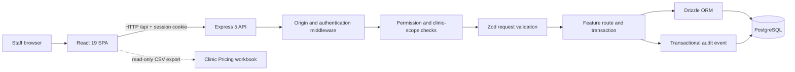

# Bark current-state assessment

**Assessment date:** 15 November 2026  
**Audience:** Supertails Product, Operations, Engineering, and Management  
**Scope:** Source and documentation review of the React/Vite application, Express API, Drizzle/PostgreSQL schema and migrations, tests, configuration, and visible integration points. Generated `dist/` output and `node_modules/` were excluded from source analysis.

## 1. Executive finding

Bark is a **local, full-stack operational prototype with a meaningful backend foundation**. It is not yet a production-ready clinic operations platform. The strongest implemented foundations are database-backed authentication and access control, transactional booking creation and history, an append-only audit design, an initial customer/pet booking path, database-backed calendar events, and an API-backed dashboard summary.

The main readiness gap is the difference between backend capabilities and the screens employees use. Escalation routes and tables exist, but the escalation screens call a `localStorage` mock service. Clinic Chat is a browser-session preview. Booking has useful creation and conflict checks but no complete appointment lifecycle and no provider/capacity-aware scheduling. Reports and parts of the agent dashboard still show fixed example values. Admin pages expose only a subset of backend administration. Email, SMS, Shopify, quote persistence, and production operations are not complete.

**Recommendation:** treat the current release as an internal pilot/prototype. Before real operational dependence, complete a controlled MVP around end-to-end booking, provider-aware scheduling, customer/pet data boundaries, escalation UI-to-API integration, notifications, audit investigation, backup/restore, and security/UAT gates.

## 2. Evidence and status definitions

Status labels used here follow the requested BRD scale:

- **Fully implemented and verified:** the capability is implemented and there is direct verification evidence for the relevant path. A successful frontend build verifies compilation, not business correctness.
- **Implemented but not verified:** source implementation is present, but a complete functional/integration run was not evidenced for this assessment.
- **Partially implemented:** a narrower workflow exists, while key business steps, roles, data, or states are absent.
- **Frontend-only or mocked:** the visible experience uses fixtures, local browser state, or preview behavior rather than the operational backend.
- **Planned but not implemented:** appears in user direction, checklist, or this BRD, but is not present as a functional feature.
- **Unknown / needs clarification:** the business rule or source of truth is not established.

Code references below are the evidence trail. Project documentation such as `PROJECT_AUDIT.md` and `BUILD_CHECKLIST.md` was considered, but current source was treated as authoritative where older documents differed. A recent `npm run build` completed successfully during the work preceding this assessment. The workspace has a small Vitest suite; it was inspected but not run as part of this documentation-only assignment. Earlier local work in this project included successful local sign-in/catalog/availability smoke checks; those checks do not constitute production or full workflow acceptance.

## 3. Repository and architecture map

| Area | Location | Observed purpose |
|---|---|---|
| Frontend bootstrap and route tree | `src/main.tsx`, `src/app/router.tsx`, `src/app/AppProviders.tsx` | React 19 app, React Router protected routes, providers |
| Shared shell and controls | `src/components/layout/`, `src/components/ui/` | Sidebar, header, profile menu, cards, buttons, loading/empty states |
| Application pages | `src/pages/` | Login, home, bookings, calendar, Pawcare, chat, guide, diagnostics, admin, profile |
| Domain UI | `src/features/escalations/`, `src/features/calendar/`, `src/features/pawcare/` | Escalation prototype/API adapter, calendar client, diagnostics workbook reader |
| API composition | `server/app.ts`, `server/index.ts` | Express middleware, routes, API health endpoint, production SPA serving |
| API endpoints | `server/routes/` | Authentication, bookings, customers, catalog, calendar, dashboard, escalations, admin |
| Access and sessions | `server/auth/`, `server/middleware/` | Password hashing, permission loading, session principal, auth/origin middleware |
| Data model and seed | `server/db/schema.ts`, `server/db/seed.ts`, `drizzle/` | PostgreSQL tables, seed roles/services/clinics, forward migrations |
| Tests | `tests/` | Password helper, pure escalation policy, migration guardrail assertions |
| Project configuration | `package.json`, `vite.config.ts`, `.env.example`, `docker-compose.yml` | TypeScript/build scripts, development API proxy, local PostgreSQL setup |

The application is a **modular monolith**: one React SPA and one Express API backed by one PostgreSQL database. It is not a microservice system. In development, Vite serves the web app and proxies `/api` to Express. In production mode, Express serves the built `dist/` SPA and API from one origin. `server/index.ts` binds the API to `127.0.0.1`; a hosted deployment would need a deliberate reverse-proxy/network configuration rather than using the current loopback setup unchanged.

### Request and data path

## 4. Module-by-module implementation assessment

| Module | Current status | Evidence and limits |
|---|---|---|
| Authentication | **Implemented; locally exercised, not production-assured** | `server/routes/auth.routes.ts`, `server/auth/password.ts`, `server/auth/session.ts`. Passwords are scrypt hashes; random opaque session tokens are stored as hashes; login and reset attempts are rate-limited; sessions can be revoked; cookies are HttpOnly/SameSite and Secure under HTTPS. There is no email delivery provider. Production TLS, secret management, and security testing remain external deployment work. |
| Role and permission foundation | **Implemented but not fully UAT-verified** | `server/auth/permissions.ts`, `server/middleware/auth.ts`, `users`, `roles`, `permissions`, `role_permissions`, `user_permissions`, `user_clinics`. API routes check permissions and some resources check clinic scope. UI route protection is sign-in based; individual action availability is not a substitute for server authorization. Effective permissions and clinic assignments need role-by-role acceptance tests. |
| Self-service account profile | **Implemented but not fully verified** | `ProfilePage.tsx` and `/api/auth/profile` support display name, phone, bio, and image data. Image data is limited and validated; this is not a document/image storage service. |
| Password recovery | **Partially implemented** | Reset tokens are hashed, expire after 30 minutes, are one-use, and reset revokes active sessions. A local reset URL can be enabled only for localhost. There is no email/SMS provider in this codebase; hosted use cannot send a reset message yet. |
| Admin Control | **Partially implemented** | `AdminControlPage.tsx` supports user listing, account creation, suspend/reactivate, and audit listing. `admin.routes.ts` has APIs for users, roles, clinics, SLA policies, assignment rules, settings, feature flags, sessions, and audit events. The UI does not expose the full admin configuration surface; bulk import, robust edits, service/provider management, and emergency workflows need review. |
| Pawcare booking | **Partially implemented; core creation path exists** | `PawcareBookingPage.tsx` searches customers by phone, creates a customer, selects/registers a pet, loads clinic services, shows available slots, and creates a booking. `booking.routes.ts` derives end time, checks pet/customer relationship and grooming coat eligibility, validates service/clinic availability, and writes booking history/audit data. Price configuration and provider selection are incomplete. |
| Booking API and schedule integrity | **Partially implemented; concurrency assumptions need redesign/verification** | `/api/bookings` supports list, create, get, reschedule, assign, cancel, and availability. Creation locks by clinic and rejects any active clinic overlap. This prevents parallel bookings even when different doctors/rooms/groomers could serve them. A separate database exclusion constraint protects overlapping assignments for the same staff. Reschedule uses staff checking but does not repeat the clinic-wide serialized conflict protocol; concurrency safety must be reviewed. The booking UI does not expose lifecycle actions. |
| Appointment calendar/queue | **Partially implemented** | `PawcareAppointmentsPage.tsx` reads booking APIs and renders a daily provider-grouped timeline and list. A fixture path is selected only when `VITE_USE_MOCK_AUTH=true`. The real booking path does not assign a provider, and the screen does not provide check-in, completion, no-show, cancellation, or rescheduling actions. |
| Customer, pet, and health records | **Partially implemented; privacy and audit coverage require urgent review** | Schema includes `customers`, `customer_pets`, `customer_health_records`, and orders; customer routes search/create customer, create pet, and return a profile with related records. The create-customer and create-pet routes do not call `appendAudit()`. `scopeFor()` returns an unrestricted customer search when an actor has booking-create permission and no clinic assignments; `/profile` scopes appointment rows, but loads that customer's pets, orders, and health rows by customer ID. These may be intentional policies, but need explicit business approval and tests before real customer data is used. Full edit and health-record CRUD are absent. |
| Escalation management | **Frontend-only in current operational UI; separate backend is implemented but disconnected** | `src/features/escalations/escalation.service.ts` selects `escalation.mock-service` unless demo/mock auth is enabled (the normal operational path). Mock service persists in `localStorage`. Independently, `server/routes/escalation.routes.ts` has PostgreSQL endpoints for list/create/detail/status/assign/tier/comments, SLA/assignment logic, notifications-outbox writes, and audit events. Until the UI adapter is switched and tested, staff do not use those backend records through the product screens. This is a production blocker. |
| Escalation notifications and attachments | **Not operationally implemented** | Backend escalation actions insert notification rows, but no worker/provider sends them. UI attachment behavior stores metadata for a demo session and explicitly does not upload the file. |
| Team calendar | **Implemented, limited scope** | `/api/calendar/events` and `CalendarPage.tsx` support list/create/edit/cancel for generic meetings/offers/feedback/other events with role checks and audit events. This is a team calendar, not a clinic resource-availability calendar, and does not yet govern booking slots. |
| Management dashboard | **Partially implemented** | `OperationalSummary.tsx` reads `/api/dashboard/summary` for role-scoped operational totals. `TodaySnapshot.tsx`, `BookingGoalTracker.tsx`, and call-quality content in `WelcomePage.tsx` contain static/sample values. The full management KPI set and report exports are not complete. |
| Agent workspace | **Partially implemented** | Home and general bookings UI exist. Some counts, targets, incentives, and quality values are fixtures. Role-specific work queues, conversion funnel, productivity definitions, and reliable reporting need business validation and data-backed APIs. |
| Clinic Chat | **Frontend-only preview** | `ClinicChatPage.tsx` uses seeded in-memory threads and local React state. Messages are not persisted or delivered; attachments are preview-only. |
| Diagnostics pricing | **Partially implemented, external read-only feed** | `DiagnosticsPage.tsx` calls `diagnostics.service.ts`, which fetches public CSV exports for four tabs from a Clinic Pricing workbook. It is a browser-side read and has no server-side cache, sync job, change audit, or guaranteed source availability. Its spreadsheet is distinct from the CX Clinic Dashboard sheet. |
| Clinic Service Guide | **Frontend-only static reference** | `GuidePage.tsx` reads `src/features/guide/guide-data.json`; it includes packages, service price reference, contacts/locations, and a Discounts tab with empty content. It is not an authoritative configurable catalog or validated promotion engine. |
| Quote generator | **Partially implemented; quote is ephemeral** | `QuoteGeneratorPage.tsx` searches active clinic services, supports editable unit prices/quantities, calculates a staff-entered approved fixed/percentage discount, records a code/reference string, and prints/saves through browser print. There is no quote persistence, central discount-code validation, approval workflow, or billing/Shopify conversion. |
| Shopify/billing | **Planned, not implemented** | No Shopify client, webhook, service-to-product mapping, invoice/payment state, or reconciliation workflow was found. |
| Audit trail | **Strong foundation, incomplete user-facing investigation** | `appendAudit()` writes actor/action/entity/before-after/reason/request/IP and sanitizes selected sensitive keys. Business mutations often call it inside the same transaction. Migration `0000` creates an UPDATE/DELETE-blocking trigger for `audit_events`. Audit events can be listed by admin; search/export/retention/monitoring and proof of every required mutation are not complete. `booking_history` is a separate domain history table. |
| Notifications | **Outbox foundation only** | `notifications` and `notification_templates` exist and escalation routes enqueue rows. No delivery worker, retries, failure queue, preferences, or confirmation channels are implemented. |
| Local runtime/deployment | **Local prototype setup present; production not ready** | README documents Node 20+, PostgreSQL 16/Docker option, Vite and API commands, migrations, and seeding. Docker Compose supplies local PostgreSQL, not an application deployment. Express has a health endpoint and production static serving. No production orchestrator, TLS termination, backup automation, monitoring, CI/CD, or restore runbook is included. |
| Tests | **Narrow source-level suite** | `tests/password.test.ts`, `tests/escalation-policy.test.ts`, and `tests/database-guardrails.test.ts` cover pure password behavior, pure escalation policy, and migration text. No PostgreSQL integration, React flow, booking concurrency, role/clinic isolation, notifications, or full E2E suite was found. |

## 5. Technical inventory

- **Frontend:** TypeScript, React 19, React Router 7, Vite 6, Tailwind CSS 4; Lucide icons.
- **Backend:** TypeScript, Node.js (README states Node 20+), Express 5, Zod request schemas, Pino logging.
- **Persistence:** PostgreSQL 16 target, Drizzle ORM and Drizzle Kit migrations.
- **Tests:** Vitest 2; no coverage script or configured CI workflow was found in the reviewed top-level files.
- **API style:** JSON REST endpoints under `/api`; session-cookie authentication.
- **Integrations:** Public Google Sheets CSV export for diagnostics pricing; static Guide JSON. No live Shopify or email provider.
- **External package footprint:** `package.json` includes the runtime and build libraries above; dependency versions are lockfile-managed. A current dependency/security audit was not run for this BRD.

## 6. Data model in brief

The schema is organized around access (`users`, `roles`, `permissions`, role/user assignments, clinic assignments, sessions, reset tokens, login attempts); operations (`clinics`, `services`, `clinic_services`, `customers`, `customer_pets`, health records, orders, bookings, booking history); escalations (cases, comments, activity, ownership history, SLA policies, assignment rules); and platform controls (calendar events, notifications/templates, application settings, feature flags, audit events). The model is a useful start but does not yet include provider schedules/capacity, clinic room/equipment resources, persisted quotes, discount rules, Shopify mappings, or chat conversations/messages.

## 7. Production blockers ranked

### Critical before staff rely on it for live operations

1. Connect escalation screens to the secured API and prove that all actions use server authorization and PostgreSQL audit history.
2. Define provider/room/capacity scheduling and enforce it atomically for create, reschedule, and assignment; replace the current clinic-wide single-slot exclusion behavior.
3. Implement appointment status and lifecycle actions, including check-in, completion, no-show, cancellation, and reasoned rescheduling.
4. Establish real clinic prices and control who may override them. Quote discounts need approval policy; quote records should be persisted if they are operational or financial commitments.
5. Define customer/pet/health-record visibility and verify clinic scoping; add record edit/history workflows.
6. Add verified automated tests around authorization, data isolation, booking concurrency, migration, escalation integration, and browser journeys.
7. Document and exercise database backup/restore; implement production TLS, secret management, restricted DB credentials, logs/monitoring, and deployment/rollback.

### Important before scale

- Deliver notification outbox processing with retries and failure visibility.
- Replace static dashboard values with well-defined data contracts and last-updated indicators.
- Add clinic schedule/time-zone/operating-hour/holiday configuration and enforce it server-side.
- Build chat persistence and permissions only after conversation ownership/retention requirements are approved.
- Integrate Shopify only after service SKU, price, tax, invoice, refund, and reconciliation ownership are signed off.

## 8. Gaps and constraints to validate

- Business hypotheses in the master prompt (manual work, errors, response delays, revenue leakage) have not been proven by baseline operational data.
- Appointment time generation currently uses 09:00–18:00 and a fixed Asia/Calcutta offset, rather than each clinic's configured timezone and `operatingHours`.
- Clinic-wide overlap protection is safe against a simple double-booking but over-restricts capacity; reschedule concurrency requires additional review.
- The seeded Bark booking services use zero base prices, while pricing references exist separately. The quote UI therefore allows manual unit-rate entry; no authoritative price governance is connected.
- The quote generator applies staff-entered discounts, but code validity, approval limits, expiry, and eligibility are not centrally enforced.
- Booking IDs use `BKG-<year>-<random UUID fragment>`; the CX dashboard sheet is primarily a reporting snapshot and does not define this app's booking ID sequence.
- Customer/pet create routes do not currently emit audit events; customer profile reads can return pets, orders, and health records beyond the booking rows that establish the actor's current clinic scope. The intended cross-clinic customer-history policy must be explicit, and the implementation must enforce it consistently.
- Appointment provider assignment is supported by an API field, but the Pawcare creation flow does not select a provider.
- Error and API behavior needs verification under unavailable PostgreSQL, expired sessions, time-zone changes, and concurrent users.

## 9. Assessment recommendation

Use Bark for controlled local demonstrations and requirements validation. Do not represent the current system as an integrated or production-ready replacement for existing booking, escalation, messaging, billing, or reporting systems. Approve a bounded production MVP only after the management decisions in the BRD are resolved and the acceptance gates in `BARK_DEVELOPMENT_ROADMAP.md` are met.

## 10. Source index

- Product/run instructions: `README.md`, `BACKEND_PLAN.md`, `BUILD_CHECKLIST.md`
- Repository audit notes (older snapshot): `PROJECT_AUDIT.md`
- Frontend routes: `src/app/router.tsx`
- API composition/security boundaries: `server/app.ts`, `server/middleware/`, `server/auth/`
- Authorization policy: `server/auth/permissions.ts`
- Schema/migrations: `server/db/schema.ts`, `drizzle/0000_watery_james_howlett.sql` through `drizzle/0004_fuzzy_mongoose.sql`
- Feature implementation: `server/routes/`, `src/pages/`, `src/features/`, `src/components/dashboard/`
- Test inventory: `tests/`
