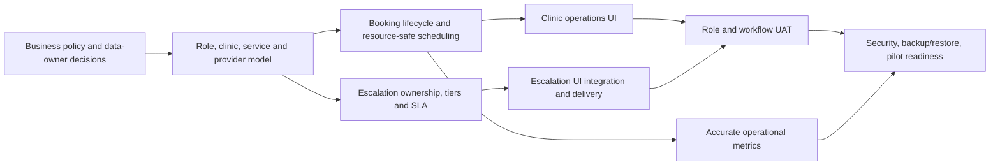

# Bark development roadmap and preliminary resource model

**Planning date:** 15 November 2026  
**Status:** Indicative plan for management review; not a committed schedule or vendor quote

## 1. Planning assumptions

- Initial pilot is one or two clinics and approximately 10–30 internal users.
- The existing React/Express/PostgreSQL modular monolith is retained for the first release unless discovery identifies a material blocker.
- Estimates are engineering person-days, where one person-day is approximately six focused hours. They exclude vendor procurement lead time and substantial data cleanup.
- A single AI-assisted engineer is available full-time, with business stakeholders, reviewers, and clinic users available for timely decisions and acceptance.
- The small-team scenario uses 3–5 contributors across product/business analysis, backend, frontend, QA/security/release; work can overlap only when contracts and decisions are ready.
- AI tools may reduce drafting/coding time but do not eliminate design review, security testing, real-database verification, UAT, or rollout support.
- Scope excludes Shopify transaction processing and persistent quote/discount administration from the minimum production MVP unless management declares them launch-critical.

## 2. Phased delivery plan

| Phase | Objective and deliverables | Engineering effort | Single AI-assisted developer calendar | Small team calendar | Critical dependencies / exit condition |
|---|---|---:|---:|---:|---|
| **0 — Discovery and requirements finalization** | Validate baseline workflows; agree role and clinic matrix; define appointment, resource, escalation, quote/pricing, privacy, reporting, data-retention, and integration rules; confirm source systems and pilot clinics. | 5–8 person-days | 1–2 weeks | 1–2 weeks | Named business owners and approved requirements; no unresolved policy that blocks schema/acceptance design. |
| **1 — Core platform foundation** | Confirm deployment architecture; harden session/RBAC boundaries; complete admin account/clinic workflows; establish migration/recovery process; add test fixtures, API contracts, logs, health checks, and audit coverage map. | 12–18 person-days | 3–4 weeks | 2–3 weeks | Phase 0 role matrix; PostgreSQL test environment; secure secret/TLS plan. Exit when clean setup, migration, sign-in, least-privilege checks, and restore rehearsal pass. |
| **2 — Booking management MVP** | Complete customer/pet workflows; provider/room capacity model; clinic timezone/operating hours; slots; atomic create/reschedule/assign; cancel/check-in/completed/no-show transitions; reasoned history; clinic appointment view. | 20–30 person-days | 4–6 weeks | 3–5 weeks | Clinic resource and service-duration policy; current clinic-wide lock design replaced/validated. Exit when concurrency, state transitions, role scope, and audit acceptance pass against PostgreSQL. |
| **3 — Escalation system** | Connect escalation pages to API; validate category and issue rules; roles, clinic scope, ownership/tier transitions, SLA clocks, comments, resolution/reopen; outbox worker and observable delivery/retry. | 15–22 person-days | 3–5 weeks | 2–4 weeks | Confirm tier/owner/SLA semantics and notification channels. Exit when agent→lead→manager→zonal/head journeys persist centrally and audit correctly. |
| **4 — Clinic operations** | Clinic queue, provider assignment, check-in, delay management, visit outcome, provider/resource schedules, operational exception handling. | 12–18 person-days | 3–4 weeks | 2–3 weeks | Appointment lifecycle and resource model from Phase 2; clinic staff UAT participation. Exit when front desk, doctor, and groomer can complete an assigned day workflow. |
| **5 — Management and administration** | Data-backed KPI dashboards; filterable clinic/agent reporting; source/freshness labels; role, clinic, service, workflow, and audit administration; exports and exception visibility. | 12–20 person-days | 3–5 weeks | 2–4 weeks | Metric definitions and source-of-truth approvals. Exit when totals reconcile to an agreed sample and access boundaries are demonstrated. |
| **6 — Integrations and advanced functionality** | Persisted chat, email/SMS or in-app notices, controlled price/discount records, quote persistence, Shopify service SKU mapping, invoice/reconciliation workflows, automation as approved. | 15–25 person-days | 4–6 weeks | 3–6 weeks | API access, security/legal/procurement approval, data contracts, business owners, and vendor response. Shopify/payment scope can extend the critical path. |
| **7 — Testing, pilot, and deployment** | Integration/E2E/security/performance testing; migration rehearsal; backup/restore; production setup; training/runbooks; one- or two-clinic pilot; feedback/rollback. | 12–18 person-days | 3–5 weeks | 2–4 weeks | Phases 1–5 complete for MVP; support rota, deployment environment, pilot success measures, and rollback authority approved. |

**Total indicative engineering effort:** 103–159 person-days across all listed phases. The recommended MVP through production pilot (Phases 0–5 plus MVP gates in Phase 7, excluding advanced Phase 6 integrations) is approximately **88–134 person-days**. Ranges are planning estimates derived from the present repository gaps and should be recalibrated after Phase 0.

Calendar estimates include normal sequencing but not long procurement, policy, data-cleanup, or stakeholder delays. The small-team calendar is not person-day effort multiplied by a single developer; it assumes parallel work after API contracts and product decisions are stable.

## 3. Minimum viable production release

### Include

- Approved pilot role/clinic access, user lifecycle, session revocation, and secure password recovery delivery.
- Customer and pet lookup/create/correction with clinic/role privacy controls.
- Clinic-specific service and price source with explicit missing-price behavior.
- Resource-aware availability and atomic booking create/reschedule/assignment.
- Cancellation with reason, check-in, completion, no-show, and history.
- Daily clinic schedule and agent/customer booking confirmation.
- Database-backed escalation UI, ownership/tier/SLA history, and at least one approved operational notification channel.
- Actionable audit-history search for booking, escalation, access, and administration events.
- Defined pilot KPIs with accurate backend sources and data freshness.
- Automated tests for auth, role/clinic isolation, scheduling conflict, audit immutability, and end-to-end pilot workflows.
- TLS, managed secrets, least-privilege DB access, backup/restore evidence, structured logs, health checks, deploy/rollback notes, and named support owner.

### Defer unless explicitly required for pilot

- Shopify checkout/invoicing and financial reconciliation.
- Real-time multi-channel chat, attachments, and long-term message retention.
- Advanced agent automation, incentive payouts, and predictive reporting.
- Broad multi-region/enterprise scale and complex resource optimization.
- Self-service customer portal or external consumer access.

## 4. Critical path

### Decisions that can block the schedule

1. Which scheduling resources are capacity-constrained: provider, room, equipment, service category, or clinic-wide capacity?
2. Who owns clinic operating hours, holidays, emergency overrides, and timezone configuration?
3. Which system owns customer identity, service catalog, service prices, and appointment IDs?
4. What actions/status transitions may each role perform, and which require a reason or approval?
5. Who owns each escalation tier, how priority differs from severity, and whether SLA pauses outside business hours?
6. What is the source and approval authority for discount codes, quote expiry, taxes, and quote acceptance?
7. What customer/pet data may cross clinic boundaries, and what retention/export rules apply?

## 5. Resource requirements

| Resource | MVP involvement | Responsibility |
|---|---:|---|
| Product/business analyst | 0.3–0.5 FTE during discovery and workflow definition | Requirements, role matrix, KPI definitions, acceptance criteria, policy decisions |
| Backend engineer | 1.0 FTE during data/API/scheduling/escalation work | Schema/migrations, authorization, transactions, API, integrations, audit, security fixes |
| Frontend engineer | 0.75–1.0 FTE during workflows and admin/reporting | Role-specific experiences, accessible forms, API integration, failure states, print/report views |
| QA / test engineer | 0.5–1.0 FTE from booking development through release | API/database integration, concurrency, permission matrix, browser journeys, regression evidence |
| Security/architecture reviewer | 3–6 person-days across design/release (estimate) | Threat model, sensitive data controls, deployment review, privilege/access assessment |
| Clinic operations representatives | 2–4 hours per pilot clinic per review cycle (assumption) | Workflow design, schedule validation, UAT, training feedback |
| Operations product owner | 2–4 hours/week during build plus release ownership (assumption) | Escalation/clinic rules, rollout decision, support and incident triage |

Roles can be combined in a small team, but code ownership/review and independent acceptance should remain explicit for high-risk scheduling and access-control changes.

## 6. Low-cost hosting shape and preliminary budget method

For 10–30 internal users, a low-complexity deployment can use one small application service serving the SPA/API, managed PostgreSQL, managed TLS/domain, scheduled encrypted backups, transactional email, and basic error/log monitoring. Keep staging separate from production, use a restricted runtime DB identity, and run schema migrations as a deployment job. The repository's local Docker Compose file is a development database setup, not a complete hosted production design.

No current vendor or Supertails procurement prices were verified. Do not treat this table as a quotation.

| Cost category | Estimate method / decision |
|---|---|
| One-time product/engineering | `approved person-days × Supertails fully loaded daily cost`; use the effort ranges above and validate after Phase 0. |
| Cloud application runtime | Obtain 2–3 internal-approved vendor quotes at required region, availability, and backup tier. |
| PostgreSQL | Quote managed PostgreSQL with storage, backup retention, point-in-time recovery, network controls, and non-prod environment. |
| Domain/TLS | Include managed certificate and DNS ownership; price depends on existing corporate services. |
| Email/SMS | Quote approved provider and expected notification volume; SMS/WhatsApp may have per-message and template approval costs. |
| Monitoring/error tracking | Prefer approved company-wide tooling; quote data retention and privacy controls. |
| Integration delivery | Shopify, Sheets API or notification services may add licensing, engineering, approval, and support fees. |
| Ongoing support | Budget a named product owner plus engineering on-call/maintenance allocation; quantify from pilot incident and change load. |

The management-ready budget should include one-time implementation, recurring infrastructure, third-party services, data migration, training, and steady-state support separately. Finance/procurement should supply local labor rates and vendor pricing; none are inferred here.

## 7. Pilot gates and success measures

Before pilot start: approved workflow/role matrix; clean database migration; security review; no high-severity permission defects; backup restore demonstrated; clinic schedule validated; and escalation delivery verified.

During pilot, record a pre-pilot baseline and compare:

- Median agent time from customer lookup to confirmed appointment.
- Percentage of bookings with complete customer/pet/service/provider fields.
- Scheduling conflict attempts and confirmed double-bookings (target zero confirmed collisions).
- Reschedule/cancellation handling time and reason completeness.
- Completed, cancelled, and no-show counts with reconciled denominators.
- Escalation first-owner time, resolution time, reopen rate, and SLA attainment.
- Notification delivery success/failure and time to operational visibility.
- Staff-reported workflow friction and support tickets per 100 bookings.
- Dashboard reconciliation error against an agreed source sample.

Target values should be set only after baseline and clinic policy review. The system should not claim ROI from unmeasured prototype behavior.

## 8. Release and support requirements

- Run clean install and upgrade migrations against a production-like PostgreSQL version.
- Automate test execution in CI; require typecheck, build, and focused integration/E2E suites before release.
- Confirm security headers, HTTPS-only cookies, trusted origin, least-privilege database identity, secret injection, and log redaction.
- Practice point-in-time restore, document RPO/RTO proposals for management approval, and rehearse rollback.
- Define release approver, clinic pilot owner, incident severity/contacts, support hours, and process for reverting application and migrations.
- Keep audit records append-only and backups protected from the same administrative failure domain as the application.
